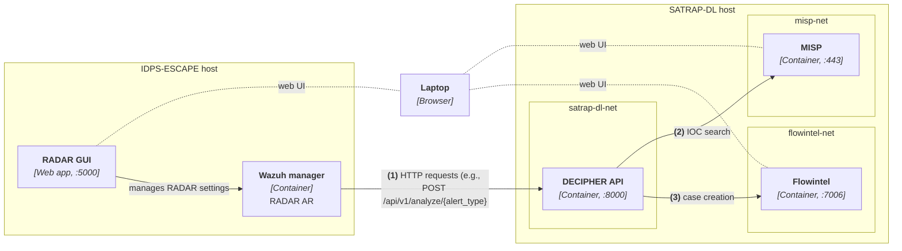

# DECIPHER integration with RADAR

This guide walks you through setting up a working integration of DECIPHER as the CTI enrichment and case creation backend of [RADAR](https://github.com/AbstractionsLab/idps-escape/tree/main/docs/manual/radar_docs).

## Table of contents

- [Architecture overview](#architecture-overview)
- [Prerequisites](#prerequisites)
- [Deploy the external services](#deploy-the-external-services)
- [Configure DECIPHER](#configure-decipher)
- [Bring up the DECIPHER API service](#bring-up-the-decipher-api-service)
- [Connect RADAR to DECIPHER](#connect-radar-to-decipher)
- [Load CTI data into MISP](#load-cti-data-into-misp)
- [Run an end-to-end test](#run-an-end-to-end-test)
- [Settings reference](#settings-reference)


## Architecture overview

The active response (AR) module of RADAR runs inside the Wazuh manager container. AR calls the DECIPHER API, which queries MISP and creates cases in Flowintel.

Here, we consider the infrastructure setting in [ARC-006](https://abstractionslab.github.io/satrap-dl/traceability/ARC.html#ARC-006), with RADAR and the DECIPHER stack deployed in two distinct endpoints:

- **IDPS-ESCAPE host**: runs Wazuh with RADAR, including the RADAR GUI.
- **SATRAP-DL host**: runs MISP, Flowintel and the DECIPHER API, each in its own Docker network.

RADAR and DECIPHER's services, i.e., the web interfaces of RADAR, MISP and Flowintel, are accessed from a third independent endpoint, e.g., the browser of a laptop. Depending on the host's setting, access to these services might be enabled only through SSH tunnels.

The integration relies on three connections, numbered in the diagram below; the dotted lines show the access from the laptop:



| Connection | Configured in | Verified by |
|---|---|---|
| (1) Wazuh manager to DECIPHER API | IDPS-ESCAPE host: RADAR GUI, Connectors page | RADAR GUI - **Connectors > Test connection** |
| (2) DECIPHER API to MISP | SATRAP-DL host: `config/decipher-settings.yaml` | `deployment/decipher_config_check.sh` |
| (3) DECIPHER API to Flowintel | SATRAP-DL host: `config/decipher-settings.yaml` | `deployment/decipher_config_check.sh` |

Connections (2) and (3) stay within the SATRAP-DL host, but they cross Docker networks, so the API reaches MISP and Flowintel through the address of the SATRAP-DL host and their published ports.

### Security assumptions

For simplicity, we will assume that both hosts are inside the same trusted boundary (e.g. a VPN): the services of both hosts are reachable within the boundary, and their ports are only internally exposed. Security aspects, such as authentication and encryption between the hosts, are thus out of the scope of this guide.

See also the RADAR [security assumptions and recommendations](https://github.com/AbstractionsLab/idps-escape/blob/main/radar/README.md#security-assumptions-and-recommendations).

In the following, `<satrap-dl-host>` stands for the IP address of the SATRAP-DL host and we will assume that the trusted boundary is implemented via a VPN.

## Prerequisites

- RADAR installed on the IDPS-ESCAPE host as described in the RADAR [getting started guide](https://github.com/AbstractionsLab/idps-escape/blob/main/docs/manual/radar_docs/radar-getting-started.md), with access to the RADAR GUI (`./radar.sh gui`, through the SSH tunnel described there)
- The DECIPHER [installation prerequisites](./installation.md#prerequisites) met on the SATRAP-DL host
- A laptop in the VPN with a web browser and SSH access to both hosts (for operations).

## Deploy the external services

On the SATRAP-DL host, prepare `deployment/.env` as described in the [DECIPHER infrastructure stack deployment](./deployment.md#configuration-setup) reference and bring up MISP and Flowintel:

```bash
cd deployment
./decipher_up.sh --misp --flowintel
```

If you already have MISP and/or Flowintel running, do a [selective deployment](./deployment.md#bringing-up-the-stack) instead. The start order of the services is irrelevant.

### Verify the services

On the laptop, create an SSH tunnel to each of the the MISP and Flowintel IPs and ports configured in the SATRAP-DL host.

For instance, assuming that the `.env` file settings are:
```
MISP_CORE_HTTP_PORT=50001
MISP_BASE_URL=https://localhost:50001
```

Then:
```
ssh -f -N -T -L 50001:localhost:50001 <user>@<satrap-dl-host>
ssh -f -N -T -L 7006:localhost:7006 <user>@<satrap-dl-host>
```

Afterwards, verify that the dashboard of each application is accessible from a browser.

## Configure DECIPHER

### Create the API keys

1. Login to MISP with the default credentials (admin@admin.test, admin) and change the password (Admin > Change password).
Then, create a user account (Administration > Add user). 

2. Login with the user account and create an API key (User profile (top right) > Auth Keys).

3. Login to Flowintel (admin@admin.admin, admin) and obtain an API key (Top right arrow > My profile > API key).

### Configure the DECIPHER service

On the SATRAP-DL host, create the three configuration files in `config/` from their templates, as described in [Configuration](./configuration.md). Check the following values.

**decipher-settings.yaml** (read at startup):

- `misp.url` and `flowintel.base_url`: addresses reachable **from inside the API container**, i.e., `<satrap-dl-host>:<port>`, not `localhost` (see [Architecture overview](#architecture-overview)).
- `flowintel.case_url`: address of Flowintel as reachable by the analysts. RADAR includes the case links built from this value in its notification emails.
- `misp.api_key` and `flowintel.api_key`: the keys created in [Create the API keys](#create-the-api-keys).

**decipher-runtime-cfg.yaml** (reloaded on every request):

- `analysis.enable_misp_search: true`
- `analysis.enable_case_creation: false`: Case creation durig DECIPHER's analysis must always be disabled given that RADAR creates cases through the API's `/incident` endpoint. With `true`, each alert would produce an additional case only reporting the results of the DECIPHER analysis, which are already included in RADAR's case.
- `misp_search.event_timestamp`: lookback window of the MISP search (default `7d`). Events not modified within the window are filtered out from searches.

## Bring up the DECIPHER API service

On the SATRAP-DL host, run

```bash
cd deployment
./decipher_up.sh --api
```

### Check the deployment of the full DECIPHER infrastructure stack

Run the deployment check script to validate that MISP and Flowintel are correctly configured and reachable for the DECIPHER API.

```sh
./decipher_config_check.sh
```

Check the API logs in case of issues: 
`docker logs decipher-api-1`.


## Connect RADAR to DECIPHER

The RADAR side of the integration is configured through the [RADAR GUI](https://github.com/AbstractionsLab/idps-escape/blob/main/docs/manual/radar_docs/radar-gui-user-manual.md) running in the IDPS-ESCAPE host, from the laptop.

### Set the DECIPHER connector

On the **Connectors** page, fill in the **DECIPHER** card and click **Save**:

- **Base URL**: `http://<satrap-dl-host>:8000`
- **SSL verification**: disabled, since the API serves plain HTTP
- **Timeout (s)**: maximum duration of each request to DECIPHER (default `30`)

Click **Save** and then **Test connection**. The test requests `<base-url>/health` from inside the Wazuh manager container; a green status confirms that connection (1) of the [architecture overview](#architecture-overview) is successful.

### Configure the scenarios

RADAR calls DECIPHER for the `suspicious_login` and `scanning_detection` scenarios.
On the **RADAR Scenarios** page, set the following values for each of these scenarios and click **Save**:

- `w_cti`: weight (%) of the DECIPHER score in the RADAR risk score. This value represents how much the outcome of the CTI analysis impacts the risk assessment of the alert. These value could be set to 0 for all the other scenarios, since DECIPHER does not cover them.
- **Upper boundary of T0** (`tier1_min`): set it above 0. Otherwise, every alert will send an email and create a case.
- **Allow automatic mitigation execution**: disable it while testing, for RADAR to plan and log mitigations without executing them.

Then deploy the scenarios on the **Deployment** page and verify them in the **Status** tab.

### Enable the debug log

To log the requests to and responses from DECIPHER, keep `AR_DEBUG_LOG=yes` in the RADAR `.env` file; otherwise, set `AR_DEBUG_LOG=no`.


## Load CTI data into MISP

A fresh MISP instance needs some minimal settings to become useful for investigations, for instance, shared vocabularies (taxonomies, galaxies, warninglists), a small set of trusted feeds, warnignlists and enrichment modules (see [MISP quick start](https://circl.lu/doc/misp/quick-start/index.html#first-steps-after-login)).

Once the integration is up and running, the next step is to prepare and populate MISP with meaningful and relevant data for your organization.

### Enable taxonomies and warninglists

Enable the taxonomies listed in [MISP instance setup](./configuration.md#misp-instance-setup) and the warninglists with the [warninglists tool](./web_scn_analyzer.md#misp-warninglists).


### Add MISP feeds

MISP-format feeds are the best starting data for investigations because they arrive as complete events with tags, galaxies and objects. The feed selection however depends on your organization's security goals. We recommend to check the [Managing feeds](https://www.circl.lu/doc/misp/managing-feeds/index.html) section of the [MISP user guide](https://www.circl.lu/doc/misp/), and the references therein, for guidelines on how to select and enable feeds.

Take into account the following:

- **Fetch and store as events**: DECIPHER searches MISP attributes, so the data of a feed that is only cached is never matched.
- **Default tag**: set an `admiralty-scale:source-reliability` tag reflecting the trust in the feed; the confidence of the DECIPHER score depends on Admiralty tags (see [decipher-scoring-cfg.yaml](./configuration.md#decipher-scoring-cfgyaml)).
- **Schedule**: fetch the feeds periodically to keep your CTI up to date.

## Run an end-to-end test

To validate the integration, we suggest carrying out RADAR's validation test [TST-057](https://abstractionslab.github.io/idps-escape/traceability/TST.html#TST-057),  which deploys the `scanning_detection` scenario through the RADAR GUI and simulates an attack; perform the optional DECIPHER steps to verify that the Flowintel case was created.

To test a flow where CTI for the alert is found, create a sample event before the test in your MISP instance with the following data:

- **Event**
  - **Event info**: `[TEST] Web scanning campaign with sqlmap`
  - **Threat level**: High
  - **Tags**: `tlp:amber`, `type:OSINT`
  - **Galaxy**: MITRE ATT&CK technique `Active Scanning - T1595`
- **Attributes** (searched by the [web scanning analyzer](./web_scn_analyzer.md))
  - `ip-src`: `198.51.100.21`
  - `uri`: `/wp-login.php`
  - `user-agent`: `sqlmap/1.7.2#stable (https://sqlmap.org)`

Remember to delete this event after the test.

## Settings reference

Here, we summarize the recommended values for the settings involved in the integration, for testing and for production environments.

| Tool | Setting | Location | Testing | Production |
|---|---|---|---|---|
| DECIPHER | `misp.url`, `flowintel.base_url` | `decipher-settings.yaml` | Address of the SATRAP-DL host | Address of the SATRAP-DL host |
| DECIPHER | `flowintel.case_url` | `decipher-settings.yaml` | Flowintel address in the VPN | Flowintel address in the VPN |
| DECIPHER | `enable_misp_search` | `decipher-runtime-cfg.yaml` | `true` | `true` |
| DECIPHER | `enable_case_creation` | `decipher-runtime-cfg.yaml` | `false` | `false` |
| DECIPHER | `event_timestamp` | `decipher-runtime-cfg.yaml` | Longer than the age of the test events | According to the feed update frequency |
| MISP | Taxonomies, warninglists | MISP UI, warninglists tool | Enabled | Enabled |
| MISP | Feeds | MISP UI | Test events only | Stored as events, tagged, scheduled |
| RADAR | DECIPHER Base URL | GUI, Connectors | `http://<satrap-dl-host>:8000` | `http://<satrap-dl-host>:8000` |
| RADAR | `w_cti` | GUI, RADAR Scenarios | According to the test plan | Tuned per scenario |
| RADAR | Upper boundary of T0 (`tier1_min`) | GUI, RADAR Scenarios | Above 0 | Tuned per scenario |
| RADAR | Allow automatic mitigation execution | GUI, RADAR Scenarios | Disabled | Tuned per scenario |
| RADAR | `AR_DEBUG_LOG` | RADAR `.env` | `yes` | `no` |

<br/>

[Back to home](./README.md)
