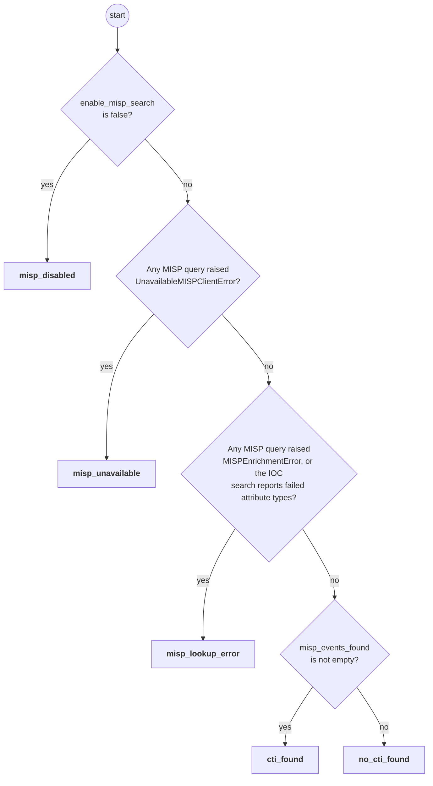

# Analysis result: status code for CTI enrichment outcome

Every response of the analysis endpoint (ARC-009) carries a top-level `cti_lookup_result` field that summarizes the outcome of the CTI enrichment with MISP, as specified in SRS-061. The status values, the rules to derive them, and the changes required in the analysis pipeline are defined below.

## Status values

The status is a string enumeration `CTILookupResult` defined in `decipher/models.py` and exposed as a required field of `AnalysisResult`.

| Value | Meaning |
|---|---|
| `cti_found` | MISP was queried successfully and at least one MISP event was retained for scoring. |
| `no_cti_found` | MISP was queried successfully and no MISP event was retained for scoring. |
| `misp_lookup_error` | MISP was reached but a query failed (API error, error response, unparseable response). Note that in bulk search, this is the outcome if any of the searches fails. |
| `misp_disabled` | MISP search is disabled in the runtime configuration (`enable_misp_search: false`). |
| `misp_unavailable` | MISP is not configured, or the connection failed at request time (connection refused, timeout, TLS failure, authentication failure). |

The identifiers are part of the public API contract. New values may be added (e.g. benign-evidence states); existing values are never renamed or redefined. Consumers must tolerate unknown values.

Example response:

```json
{
  "analyzed_scenario": "suspicious_login",
  "cti_lookup_result": "cti_found",
  "severity": 0.72,
  "report": {"misp_available": "True", "misp_events_found": [1532], "misp_failed_lookups": [], "log_summary": [], "score_breakdown": []},
  "created_case": {"id": 0, "link": ""}
}
```

## Status derivation

The status is computed in `MISPCTIAnalyzer.analyze()` before case creation, and returned independently on whether case creation is enabled, suppressed, or fails.

An analysis may run more than one MISP query: the IOC search and, optionally, scenario-specific lookups in `extend_analysis()` (e.g. the known-scanner lookup of the network scanning scenario, ARC-016). When outcomes differ, the status with the highest precedence is reported:

| Precedence | Condition | Status |
|---|---|---|
| 1 | `enable_misp_search` is false | `misp_disabled` |
| 2 | Any MISP query raised `UnavailableMISPClientError` | `misp_unavailable` |
| 3 | Any MISP query raised `MISPEnrichmentError` (other than the above), or the IOC search reports failed attribute types | `misp_lookup_error` |
| 4 | `misp_events_found` is not empty | `cti_found` |
| 5 | Otherwise | `no_cti_found` |

On `misp_unavailable` and `misp_lookup_error`, the error message is appended to `log_summary` and the severity is computed over the events retrieved before or despite the error. Under `misp_unavailable` no events are retrieved and the severity is 0. Under `misp_lookup_error` the events of the successful searches are scored and listed in `misp_events_found`, and the MISP attribute types whose search failed are listed in `misp_failed_lookups`; since the Noisy-OR aggregation (ARC-010) never decreases when events are added, the reported severity is a lower bound of the severity of a complete search. Case creation proceeds on that severity as in any other analysis.

### Status assignment decision flow



## Error classification

The statuses `misp_lookup_error` and `misp_unavailable` are distinguished by the scope of the failure:

- A failure that affects every query to MISP, independently whether a query was sent, makes MISP unusable for the analysis and persists until MISP or the DECIPHER configuration is fixed. Thus, it maps to `misp_unavailable`
- A failure that affects a single query maps to `misp_lookup_error` since other queries of the same analysis, or later analyses, may still succeed.

These cases should be handled by two independent exception classes:

- `UnavailableMISPClientError`, defined in `decipher/commons/misp_connector.py`, maps to `misp_unavailable`. It is raised when:
  - the MISP extractor cannot be created (missing URL or API key, or PyMISP initialization fails because MISP cannot be reached or rejects the key);
  - a query fails with `requests.exceptions.ConnectionError` or `requests.exceptions.Timeout` (this includes TLS errors and connect/read timeouts);
  - MISP answers a query with HTTP 401 or 403, meaning that the credentials are rejected. This cause is classified the same way whether it occurs when the extractor is created or at request time.
- `MISPEnrichmentError`, defined in `decipher/analyzers/mixins/misp_enrichment.py`, maps to `misp_lookup_error` for any other failure while querying MISP or parsing its response.


## Deprecation of `misp_available`

The `misp_available` report entry is deprecated in favor of `cti_lookup_result` and kept in the analysis report for consumers of v1.0 and v1.1. It keeps its previous type and meaning and is derived from the status:

| `cti_lookup_result` | `misp_available` |
|---|---|
| `misp_disabled`, `misp_unavailable` | `"False"` |
| Any other value | `"True"` |

`MISPCTIAnalyzer.analyze()` sets the entry once the status is computed, including in the early return taken when MISP search is disabled. Overrides of `retrieve_misp_cti()` no longer set it. The description of the `report` field in the API schema marks `misp_available` as deprecated, and the release notes of the version that introduces `cti_lookup_result` announce the deprecation encouraging new consumers to read `cti_lookup_result` instead.

## Out of scope

- Input validation errors are returned as HTTP 422 before any analysis runs (SRS-050) and carry no analysis status.
- The health check endpoint does not query MISP and is not affected.
- The outcome of case creation stays in `created_case` and `log_summary`.