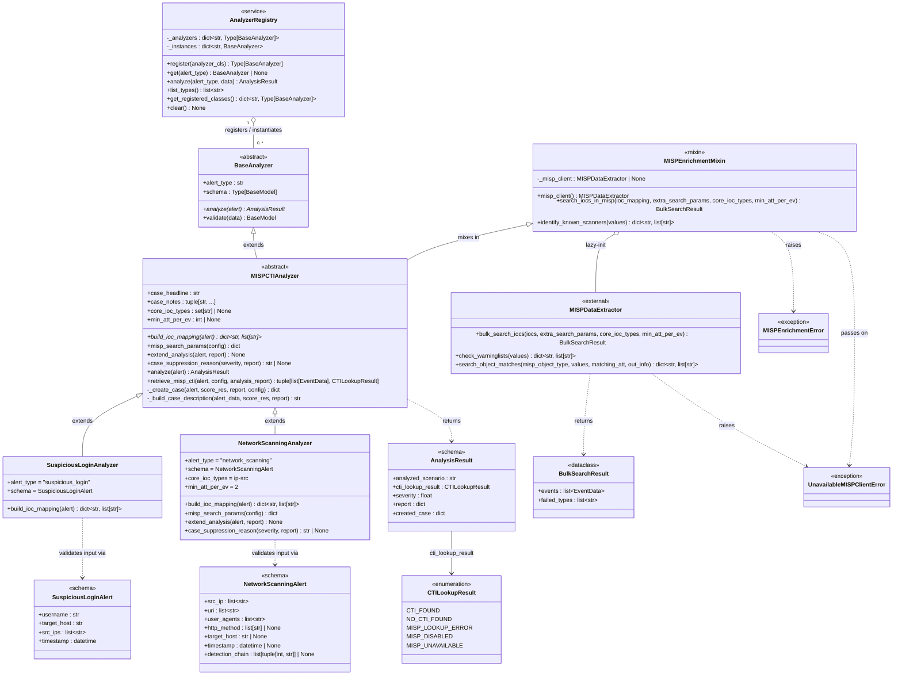

# Analysis layer class diagram

This diagram expands the **Analysis Layer** node from [SWD-011](SWD-011.md) into a UML class diagram, showing the concrete classes, their relationships, and the key attributes and operations exposed by each.

`AnalyzerRegistry` is the single static dispatcher; it holds class and instance registries keyed by `alert_type` and routes every analysis request. `BaseAnalyzer` defines the mandatory contract every analyzer must satisfy: a class-level `alert_type` string, a class-level `schema` (a Pydantic `BaseModel` subclass), and an abstract `analyze()` operation.

`MISPCTIAnalyzer` combines `BaseAnalyzer` with `MISPEnrichmentMixin` and implements `analyze()` once for every scenario assessed with MISP threat intelligence: IOC search, scenario-specific extensions, scoring, case creation and report assembly. A concrete scenario analyzer supplies `alert_type`, `schema`, `case_headline` and `build_ioc_mapping()`, and customizes the pipeline through the hooks `misp_search_params()`, `extend_analysis()` and `case_suppression_reason()`, and through the event filters `core_ioc_types` and `min_att_per_ev`.

`SuspiciousLoginAnalyzer` and `NetworkScanningAnalyzer` are custom analyzers.

`MISPEnrichmentMixin` gives lazy access to the shared `MISPDataExtractor`, so that no MISP connection is attempted when MISP search is disabled. Its operations return the results of the extractor; `UnavailableMISPClientError` is raised when MISP cannot be used at all and `MISPEnrichmentError` when any other failure occurs.

`AnalysisResult` (from `decipher.models`) is the response schema of the `/analyze` endpoint.

